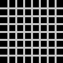
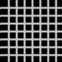
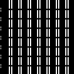
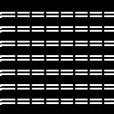

# configurable-2d-convolution-accelerator

A streaming $3 \times 3$ 2D image convolution accelerator implemented in Verilog HDL. Designed to process $128 \times 128$ 8-bit grayscale image frames with configurable signed kernel weights and dynamic bit-shift scaling.

## Examples

Input and outputs for the same 128×128 image:

| Original | Gaussian blur | Sobel X | Sobel Y |
|:---:|:---:|:---:|:---:|
|  |  |  |  |


## Features

- 128x8 circular line buffer and 3x3 register grid to maintain sliding 3x3 window over streaming pixels.
- Accepts 9 configurable 8-bit signed kernel weights through top level port, supporting dynamic reconfiguration.
- Dynamic scaling through `shift_amount`, for gain normalization in filters like gaussian.

- Fully pipelined spatial multiply-accumulate (MAC) datapath and adder tree, achieving timing closure at **150 MHz** on a Xilinx Zynq-7020 FPGA.


## Architecture


The design has two modules, window_gen.v and convolution.v, joined in top.v.

**Window generation (window_gen.v)**

Two line buffers 128 deep, hold the past 2 rows of the image while we receieve the current pixel, the line buffers and pixel_in connect to a 3x3 grid of registers which creates a 3x3 convolution window.

The window counters count rows and columns, to detect pixels which are near the boundary or those whose convolution window does not lie entirely within the 128x128 image, in those cases valid is driven down for that pixel so the output can be discarded for that pixel, Hence, for a 128x128 input we get a 126x126 output.


**Convolution (convolution.v)**

  1. `mul00 - mul22`: multiply each of the nine window pixels by its kernel weight and register it.
  2. `sum_row0 - sum_row2`: add the three products in each row and register it..
  3. `temp_sum`: add the three row sums, apply `shift_amount` scaling and register it.
  4. `pixel_out`: take the optional absolute value (`abs_en`), saturate to 255 and register the result.

The valid signal is also pipelined, so it is registered at `valid_out` at the same time as its corresponding pixel is registered at `pixel_out`

## Interface


| Port | Dir | Width | Description |
|---|---|---|---|
| `clk` | in | 1 | Clock |
| `rst` | in | 1 | Reset |
| `pixel_in` | in | 8 | Input pixel stream |
| `shift_en` | in | 1 | Pipeline enable signal (needs to be held high) |
| `k00-k22` | in | 9×8 | Signed kernel weights |
| `shift_amount` | in | 8 | Right-shift scaling for normalization |
| `abs_en` | in | 1 | Absolute value enable |
| `pixel_out` | out | 8 | Output pixel |
| `valid_out` | out | 1 | Output pixel valid |

## Utilization and Timing

Synthesised and Implemented in Vivado for Zynq7020 (`xc7z020clg400-1`)

| Resource | Used | Available | Utilization % |
|---|---|---|---|
| Slice LUTs | 323 | 53,200 | 0.61% |
| LUTRAM | 64 | 17,400 | 0.37% |
| Slice Registers | 174 | 106,400 | 0.16% |
| DSP Slices | 9 | 220 | 4.09% |


| Metric | Value |
|---|---|
| Clock period | 6.67 ns |
| Target Frequency | 150 MHz |
| WNS (setup) | +0.151 ns |
| Fmax | ~153.4 MHz |


## Testing

To run the test suites, clone the repository first:

```bash
git clone https://github.com/ryanvfpga/configurable-2d-convolution-accelerator
cd configurable-2d-convolution-accelerator/
```

### Prerequisites

* **Icarus Verilog (iverilog)**
* **Python 3** with **Pillow**:


```bash
pip install pillow
```

### Running the simulation

Run the script from the repository root, passing the path to any image, (run_sim.py executes all (filters) in `tb/`)

```bash
python run_sim.py images/image1.png
```

The script converts the image to 128×128 grayscale and then simulates all filters in `tb/`: Sobel X, Sobel Y and Gaussian blur. Each result is saved as a 126×126 PNG in an `output/` folder next to the input image:

```
images/output/image1_sobelx.png
images/output/image1_sobely.png
images/output/image1_gaussianblur.png
```

You can modify the filters, by creating your own file in `tb/` and passing your kernel weights, as well as other parameters like shift_amount and abs_en.

Some example test images are given in `images/`

## Future Work

- Work on boundary pixel replication or ways to ensure that output image size remains same as input image size.
- Remove hardcoded 128x128 limit, and make it fully parameterizable to support any image size.
- 


