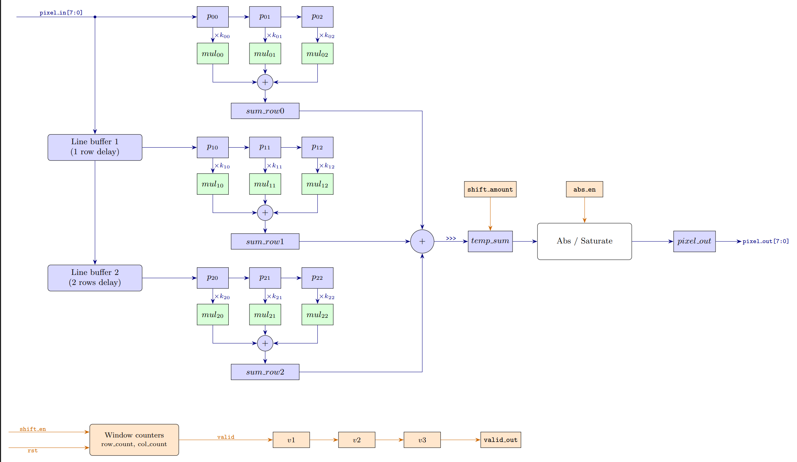

# configurable-2d-convolution-accelerator

A streaming $3 \times 3$ 2D image convolution accelerator implemented in Verilog HDL. Designed to process $128 \times 128$ 8-bit grayscale image frames with configurable signed kernel weights and dynamic bit-shift scaling.

## Features

- BRAM based circular line buffer to maintain sliding 3x3 window over streaming pixels.
- Accepts 8 configurable 8-bit signed kernel weights through top level port, supporting dynamic reconfiguration.
- Dynamic scaling through *shift_amount*, for gain normalization in filters like gaussian.

- Fully pipelined spatial multiply-accumulate (MAC) datapath and adder tree, achieving timing closure at 160 MHz on a Xilinx Zynq-7020 FPGA.

## Architecture




The design has two modules, `window_gen` and `convolution`, joined in `top`.

**Window generation (`window_gen`)**
- Two line buffers, each delaying the pixel stream by one image row (128 pixels), are chained so the current row and the two rows above it are available together.
- A 3×3 grid of registers (`p00` to `p22`) shifts the three rows sideways, so a full 3×3 window is ready every clock.
- Row and column counters track the position in the frame and drive `valid`. It drives low, at times of boundary/corner pixels thus making the output 126x126.

**Convolution (`convolution`)**

  1. `mul`: multiply each of the nine window pixels by its kernel weight and register it.
  2. `sum_row`: add the three products in each row.
  3. `temp_sum`: add the three row sums and apply the `shift_amount` scaling.
  4. `pixel_out`: take the optional absolute value (`abs_en`), saturate to 255 and register the result.


## Utilization and Timing

Synthesised in Vivado for Zynq7020 (`xc7z020clg400-1`)

| Resource | Used | Available | % |
|---|---|---|---|
| Slice LUTs | 852 | 53,200 | 1.60% |
| Slice Registers | 335 | 106,400 | 0.31% |
| Block RAM Tile | 1 | 140 | 0.71% |


| Metric | Value |
|---|---|
| Clock period | 6.25 ns |
| WNS (setup) | +0.153 ns |
| Fmax | ~164 MHz |


## Testing

To run the test suites, clone the repository first:

```bash
git clone https://github.com/ryanvfpga/configurable-2d-convolution-accelerator
cd configurable-2d-convolution-accelerator/
```

### Prerequisites

* **Icarus Verilog (`iverilog`)**
* **Python 3** with **Pillow**:

```bash
pip install pillow
```

### Running the simulation

Run the script from the repository root, passing the path to any image:

```bash
python run_sim.py images/image1.png
```

The script converts the image to 128×128 grayscale and then simulates three filters in turn: Sobel X, Sobel Y and Gaussian blur. Each result is saved as a 126×126 PNG in an `output/` folder next to the input image:

```
images/output/image1_sobelx.png
images/output/image1_sobely.png
images/output/image1_gaussianblur.png
```

Intermediate hex files and compiled simulations go in `build/`.

The testbenches live in `tb/` and the RTL in `rtl/`. Because the script uses relative paths, run it from the repository root.